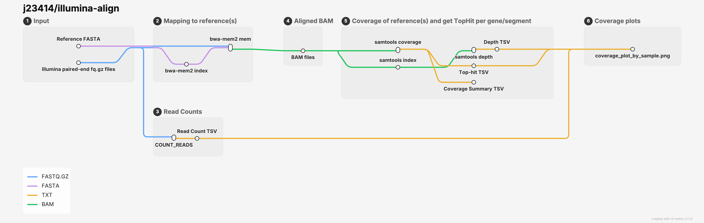

# illumina-align

A modular workflow for aligning Illumina sequencing data and summary statistics prior to downstream analysis.



## Usage

```
nextflow run j23414/illumina-align \
  --samplesheet samplesheet.csv \
  --reference reference.fasta \
  -profile stjude
```

| parameter | description |
|:--|:--|
| `--samplesheet` | CSV file of "sample,R1,R2" |
| `--reference` | FASTA file of reference(s) to align against |
| `--keep_multimapped` | Keep multimapped reads instead of only the top alignment position (default=false) |
| `--segments` | Get the top hit reference by segment (default="HA NA PB2 PB1 PA NP MP NS"), must be in the reference header as the final pipe-delimited annotation |
| `--plot_depth` | If a ggplot2 plot of depths along the reference should be generated (default= false)|

## Outputs

A non-exaustive list of outputs

```
|_ align-results/
  |_ results-coverage.tsv # <= based on coverage and average depth, subtyping
  |_ results-depth.tsv    # <= depth along the references, send to shiny app to place variants in context
  |_ bwamem2_mem/         # <= alignments, can send to variant, depth, consensus, or filter calling
  |_ processed_samplesheet.tsv # <= samplesheet to use in downstream pipelines
```